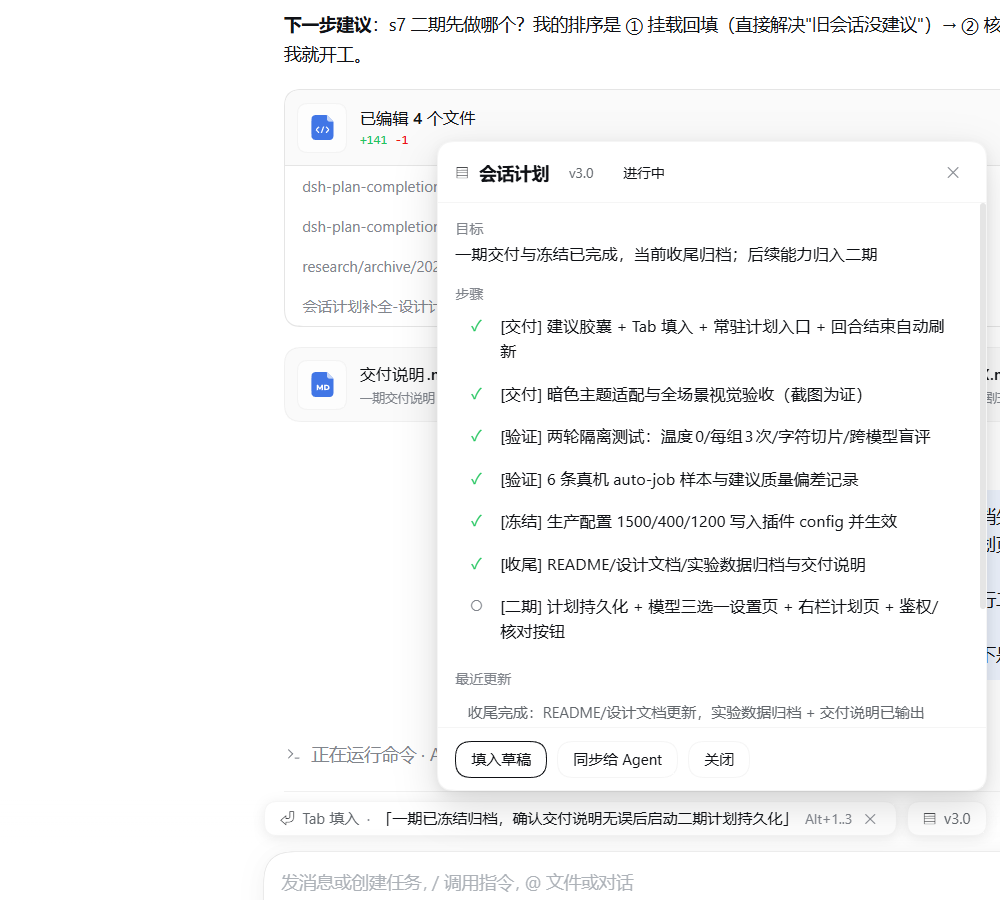

# Plan Completion（计划补全）

[](https://github.com/Xumi0920/dsh-plan-completion/actions/workflows/test.yml)
[](https://www.npmjs.com/package/dsh-plan-completion)

DSH 插件：为每个会话维护一份**隐式计划**，在每个回合结束后，于输入框上方给出一句可用 `Tab` 填入的「下一句」建议；输入框上方的 `▤ vX.Y` 是常驻入口，可查看/同步计划。


- 设计文档：`docs/design-v1.2.md`
- **交付说明（一期）**：`docs/delivery-notes.md`
- **实验数据归档**：`docs/experiment-archive.md`
- 二期计划：`docs/phase-2-plan.md`
- **发布评估 / 发布清单**：`docs/publish-assessment.md`
- **安全与隐私边界（当前修复）**：[docs/security.md](docs/security.md)
- 契约探测报告：`docs/p0-contract.md (local research artifact)`
- 运行时诊断日志：`research/plan-completion-runtime.jsonl (local log)`

## 常驻与回填（P0）

- **建议条常驻**：会话无计划时显示虚线提示胶囊「发送一条消息后自动生成计划与建议」+ `▤ 计划` 入口，栏位不会消失。
- **hero 常驻入口**：没有 Session 的页面（新会话 hero）/清空会话后，`shell.overlay` 会在输入框上方浮一个 `▤ 计划` 入口，点击打开计划面板。
- **旧会话回填**：打开插件从未观察过的历史会话时，Client 会 `POST /plan-completion/warm`，Host 从持久化会话日志重建计划+建议（每会话 10 分钟内只回填一次；无 `sessionPersistence` 时静默跳过）。





## 它不会做什么

- 不改 agent 行为、不注入系统提示词、不给模型加工具；
- 不往会话日志写任何新内容（计划只在插件内存里）；
- 不自动发送消息（`Tab` 只填入草稿）。

## 结构

| 文件 | 作用 |
|---|---|
| `index.js` | Host 半：三条触发路径 → 计划作业 → 内存状态 → `GET /plan-completion/state`；`/roadmap`、`/replan` 命令 |
| `client.js` | Client 半：`conversation.input.dock` 建议条 + 常驻入口；`shell.overlay` 计划 Popover；Tab/Esc/Alt+1..3/Ctrl+Alt+P |
| `host/*.js` | 与 DSH 解耦的纯逻辑：计划模型、prompt、启发式、证据、作业队列、存储（有单测） |
| `test/*.test.js` | `node --test` 单测（含 Host 接线、Client 生命周期与安全回归） |
| `locale/*.json` | Plugin Manager / Settings 显示用标题与描述 |

## 触发链路（三条并存，按 `sessionId+turn` 去重）

| 路径 | 触发条件 | 依赖事件投递 |
|---|---|---|
| `session/event` | 收到 `turn/end`（reason=completed） | 是 |
| `agent/status → idle` | 代理转空闲，回读日志里最后一条 turn/end | 是 |
| `idle-log-scan` | 会话日志安静 2 秒后回读日志里的 turn/end（只认 5 分钟内的，避免重放旧回合） | **否** |

三条路径同时命中只跑一次。作业在 ~2 秒内完成（模型调用 + 提交），建议先由启发式「首帧」立即发布，模型返回后在 6 秒内覆盖。

## 数据通道（已实测）

Client ⇄ Host 唯一通道是本地 HTTP 路由（`ctx.get('webServer').register`，逐条 exact 路由；`prefix` 路由在本版本不生效）：

- `GET /plan-completion/state?sessionId=<id>&reason=<kind>&running=<值>`
- `POST /plan-completion/warm` `{sessionId}`（旧会话回填：从持久化日志重建计划+建议）
- `POST /plan-completion/replan` `{sessionId, instruction?}`（生产路由，须通过宿主鉴权）
- `POST /plan-completion/verify` `{sessionId}`（「核对进度」：一次模型调用返回差异清单，不修改计划）
- `GET /plan-completion/debug?sessionId=<id>`（仅显式启用调试路由后可用）

> 生产路由：`state`、`replan`、`warm`、`verify`；所有路由先调用 `connection.requestRejection(req)`。
> 调试路由：`debug`、`diag`、`theme`、`experiment`、`autojob`、`steps`、`reset` —— 仅当 `config.enableDebugRoutes: true` 时注册。

Client 侧用 `fetch(..., {credentials:'same-origin'})`；Electron 的 `dsh-app://app` 页面经主进程转发，响应体可读、自动带 `dsh-auth` cookie。

Client 侧关键 API（实测）：`inputActions.captureInsertion()` 返回 `{start,end,draftRev}`；`insertText(text, span)`；`setDraft(text)`；`useInput(s => s)` 返回 `{draft, attachmentIds, draftRev, phase, occurrences, queue}`。

## 核对进度（v0.1.3）

- 计划面板底部「核对进度」按钮 → `POST /plan-completion/verify {sessionId}`（生产路由，需宿主鉴权）；
- Host 用**一次**受控模型调用对照「当前计划 + 最近证据」，返回 `{assessment, mismatches[], suggestion}`，**不修改计划**；
- 面板内展示结论、差异列表与下一步建议；同一会话同时只允许一个核对请求，8s 超时/解析失败返回降级错误，`modelCalls:false` 时禁用模型调用；
- 输出预算 `maxTokensVerify`（默认 600）；核对结果仅内存展示，不落盘。

## 计划持久化（v0.1.2）

- 计划 + 最近一条建议按会话持久化到本地文件（`storageDir/plans/<base64url(sessionId)>.json`，原子写）；
- 插件启动/打开会话时按需恢复（`GET /state` 前 hydrate），**DSH 重启后仍能看到原计划与版本**，无需等下一回合；
- 每次成功提交（含用户编辑、reset）同步落盘；`reset` 会同时删除磁盘记录；
- 默认目录 `~/.dsh/plan-completion-data`；可用 `storageDir` 改到别处，`persistPlans: false` 退回纯内存；
- 注意：存储为本地明文 JSON（含计划/建议文本，可能来自会话）；不加密、不自动清理，不适合多用户共享机器。

## 模型路由与隐私

- 仅使用宿主 `agentDefaultModel.currentSelection()` 当前默认的 provider/model，不自动改投其他已配置供应商；无可用路由时使用启发式。该默认值不一定是历史会话原先使用的模型。
- 模型输入包含近期对话、工具错误和计划证据；裁剪长度不等于脱敏。`warmBackfill: false` 关闭旧会话回填，`modelCalls: false` 关闭本插件全部模型请求。
- 空输出或非法 JSON 最多重试一次；使用推理模型时仍可能更慢或触发超时。调试实验评审使用同一选定路线，不再宣称独立跨模型评审。
- 访问控制、日志和剩余风险见 [安全与隐私边界](docs/security.md)。

## 生产配置（已冻结，写入插件 config）

隔离测试结论落到 `cordis.patch.yml` 的插件行 config，经 `apply(ctx, config)` 读取；运行日志仅保留操作元数据：

```yaml
- insert:
    - id: plan-completion
      name: 'dsh-plan-completion'
      config:
        evidenceChars: 1500
        maxTokensPatch: 400
        maxTokensRewrite: 1200
        warmBackfill: true
        modelCalls: true         # false：本插件仅用启发式，不向模型发送内容
        persistPlans: true       # false：计划只存内存
        storageDir: '~/.dsh/plan-completion-data'
        enableDebugRoutes: false   # 本地调试时才打开        # debugDir: '<本地日志目录>'  # 可选；发布版留空
```

| 配置项 | 默认 | 作用 | 依据 |
|---|---|---|---|
| `evidenceChars` | 1500 | patch 路径证据 JSON 的字符预算（超出按字段优先级裁剪；rewrite 不受限） | 第二轮实验：800~2000 字符最稳，更多无收益 |
| `maxTokensPatch` | 400 | patch 路径输出上限（实测只需 65~120 tok） | 真机 6 样本：输出 75~113 tok |
| `maxTokensRewrite` | 1200 | rewrite/冷启动输出上限（要输出完整步骤表） | 700 会截断，1200 稳定 |
| `warmBackfill` | true | 打开「插件从未观察过的旧会话」时，从持久化会话日志回填一次计划+建议 | P0-1；真机老会话回填 2.2s |
| `persistPlans` | true | 是否把计划+最近建议持久化到本地文件（DSH 重启恢复） | v0.1.2 |
| `storageDir` | `~/.dsh/plan-completion-data` | 计划文件目录；`~` 会展开为 home；也可用 `DSH_PLAN_COMPLETION_STORE_DIR` | v0.1.2 |
| `maxTokensVerify` | 600 | 「核对进度」单次模型调用的输出预算 | v0.1.3 |
| `enableDebugRoutes` | false | 是否注册 `debug/diag/theme/experiment/autojob/steps/reset` 调试路由；仍须鉴权 | 发布版最小攻击面 |
| `modelCalls` | true | false 时关闭本插件全部模型调用，使用启发式 | 隐私控制 |
| `debugDir` | 空 | 调试日志/实验结果的落盘目录（也可用 `DSH_PLAN_COMPLETION_DEBUG_DIR`）；空则不写文件 | 可移植性 |

验证记录：`host-ready` 日志 `settings={evidenceChars:1500,maxTokensPatch:400,maxTokensRewrite:1200,warmBackfill:true,...}`；同一宿主上 force（rewrite）调用 `maxTokens:1200`、自动 job（patch）调用 `maxTokens:400`，与配置一致。

## 安装 / 卸载

> npm：[`dsh-plan-completion`](https://www.npmjs.com/package/dsh-plan-completion)（版本见上方 npm badge）。
> DSH 的 profile 安装仍以仓库 `link:` 或路径安装为准（包内是 `dsh.bundle.patch` + `dsh.client` bundle）。

```powershell
# 安装（profile 级，一次即可）
plugin_manager install_bundle target='.'

# 卸载
plugin_manager remove_bundle target='dsh-plan-completion'
```

装完用 `cordis_inspect_query(platform:'client', provider:'Slots', method:'listSubTree', input:{root:'conversation.input.dock'})` 确认 occupant `plan-completion-dock`（order 30）。

### 冷启动与热更新（重要）

- **Host 半**：`apply()` 不在启动时快照服务，路由/命令用 `ctx.inject(['webServer'|'commands'], …)` 延迟注册 —— 因此 DSH 冷启动时插件先于服务激活也能正常起来（旧版在该场景会静默不注册路由）。
- **修改 Host 代码（`index.js` / `host/*.js`）**：需要一次 profile 重组（对任意插件做一次 `set_plugin` 开关，或重新 install）才会加载新代码。
- **修改 `client.js`**：桌面端对 linked 本地包**不做可靠热更新**；改完后需要在 DSH 窗口按 **Ctrl+R 刷新页面**（或重启应用）才会加载新 bundle。刷新后可看 `client-diag` 记录确认 `build` / `hasPill` / `hasEntry` / `rowHeight`。

### 诊断与截图验证

- `GET /plan-completion/debug`：事件计数、最近触发；`?sessionId=<id>` 附带该会话最近 60 条事件类型。
- `POST /plan-completion/diag`：客户端在 module-load / dom-check / theme-* 上报 `build`、`hasPill`、`hasEntry`、`entryText`、`suggestVisible`、`rowHeight` 及胶囊计算样式。
- `POST /plan-completion/theme` `{mode:'dark'|'light'|'system'}`：测试钩子，把主题指令放进 state 的 `debugTheme` 字段，客户端下一次拉取时通过 `ctx.theme.setTheme` 应用（用于自动化暗色/浅色截图验证）。
- `research/tools/`：`capture-window-clean.ps1`（DPI 感知的窗口截图）、`bring-front-capture.ps1`（置前全屏截图）、`reload-page.ps1`（向 DSH 窗口发 Ctrl+R）、`click.ps1`（DPI 感知鼠标点击），用于无人值守 UI 验证。

### Token 预算隔离测试（`/plan-completion/experiment`）

用固定会话快照 + 固定计划，切片「证据窗口（最近事件数）」与「输出 maxTokens」，每个组合 2 次重复，用第二个模型调用做盲评（coherence / specificity / consistency / usable），结果保存在 `research/plan-completion-experiment.json`。

第一轮结果（deepseek-account / deepseek-flash，24 组，共 24+24 次调用）：

| 维度 | 结果 |
|---|---|
| 输出 maxTokens 300 | 平均分 **4.38/5**、usable **100%**、解析成功率 100%、平均输出 122 tok |
| 输出 maxTokens 600 | 平均分 4.17/5、usable 100%、平均输出 129 tok |
| 输出 maxTokens 900 | 平均分 4.13/5、usable 100%、平均输出 133 tok |
| 证据窗口 24 事件 | 平均分 4.67/5（最好，且输入最省） |
| 证据窗口 48/96/192 | 3.39 / 4.50 / 4.33，无单调提升（受 evidence 字段上限截断，输入 tokens 基本饱和） |

结论与建议：
- **稳态（已有计划、patch 路径）**：输入约 **300~500 tokens**、输出上限 **300~400 tokens** 就足够（解析 100%、usable 100%），把 `maxTokensPatch` 从 800 降到 ~400 可再省一半输出、延迟略降。
- **冷启动/强制重写（rewrite 路径）**：需要输出完整步骤表，实测 ~1200 maxTokens 才稳定不截断（合计约 2.1k tokens/次）。
- 证据窗口继续加大**没有收益**（每字段有 1500 字/6 条消息/20 条工具调用的上限，输入已饱和），保持当前 caps。
- 局限：单会话/单计划快照、judge 与主模型同族、重复次数少（同一窗口分数非单调，属噪声）；更严谨可做温度 0、3 次重复、盲评 + 人工抽样。

**第二轮（最终版：温度 0、每组 3 次、显式字符切片、跨模型 judge、27/27 评分成功）**

- 变量：证据字符预算 `800 / 2000 / 4000`（实际裁到 1121 / 1914 / 3734 字符）× 输出 `200 / 300 / 500`，共 27 组；
- judge：自动挑选「与主模型不同」的模型并逐个预检凭证（`deepseek-official` 在本 profile 的 key 无效，被预检跳过；最终用 `deepseek-v4-pro`，`reasoningEffort=off`）。**注意：本机没有可用的跨 provider 模型，因此是「跨模型、同 provider」，不是严格跨厂商。**
- judge prompt 修正：允许「候选给出具体证据的进度更新」，避免把合理更新误判为虚报（第一轮 4000 档骤降主要就是这个评分口径问题）。

| 证据预算 | 盲评分（/5） | usable | 解析 | 平均输出 |
|---|---|---|---|---|
| 800（实裁 1121 字符） | **4.67** | 100% | 100% | 76 tok |
| 2000（实裁 1914） | **4.67** | 100% | 100% | 64 tok |
| 4000（实裁 3734） | **4.67** | 100% | 100% | 64 tok |

| 输出预算 | 盲评分 | usable | 解析 | 平均输出 |
|---|---|---|---|---|
| 200 | 4.63 | 100% | 100% | 71 tok |
| 300 | 4.67 | 100% | 100% | 65 tok |
| 500 | 4.70 | 100% | 100% | 67 tok |

结论（结合人工抽检 12 条）：
- **证据 800~1200 字符已足够**：三档 12 条建议质量一致（都是具体、可执行、与计划一致的下一步），增加历史不改变建议，只是多花 token。
- **输出 200~300 tokens 足够**：27 组全部解析成功、建议 100% 可用，实耗输出仅 55~85 tokens；500 无收益。
- 稳态单次成本：新鲜输入约 200~420 tokens（其余走 KV cache 命中）、输出 ~65 tokens；冷启动 rewrite 约 1.2k 输出上限。
- 已落地：patch 路径证据裁剪 **1500 字符**、`maxTokensPatch` **400**（相对本次最优值略保守，留余量）；rewrite 仍用完整证据 + 1200。
- 局限：单会话/单计划快照；judge 同 provider（无跨厂商可用凭证）；judge 分数接近上限（4.67 均匀），对差异不敏感；输出在温度 0 下高度重复。

### 真机自动 job 6 样本偏差记录（生产配置：证据 1500 字符 / maxTokens 400）

通过 `/plan-completion/autojob` 触发**真实 runGeneration 的 patch 路径**（与 turn/end 触发同一函数，仅触发源不同），分两批各 3 次采样；原始数据见 `research/autojob-samples.json`。

| 批次 | # | 延迟 | 新鲜输入 | 缓存读 | 输出 tok | 建议字数 | 建议 |
|---|---|---|---|---|---|---|---|
| A | 1 | 1251ms | 868 | 256 | **75** | 21 | 继续跑3条样本，记录输出长度与建议质量偏差 |
| A | 2 | 1384ms | 228 | 896 | **83** | 24 | 继续跑3条样本，比对输出长度与建议质量后记录结果 |
| A | 3 | 1528ms | 228 | 896 | **85** | 23 | 先跑3条样本，输出长度与建议质量达标即冻结配置 |
| B | 4 | 1288ms | 826 | 256 | **113** | 36 | 记录3条样本偏差后，冻结配置：证据1500字符、maxTokens400 |
| B | 5 | 1298ms | 849 | 256 | **85** | 24 | 记录3条样本偏差后，把s4标记完成并冻结生产配置 |
| B | 6 | 1318ms | 209 | 896 | **85** | 23 | 继续跑完3条样本，记录建议长度与质量偏差后汇总 |

偏差统计（6 条）：

| 指标 | min | max | mean | 两批均值 A / B |
|---|---|---|---|---|
| 输出 tokens | 75 | 113 | 87.7 | 81.0 / 94.3 |
| 建议字数 | 21 | 36 | 25.2 | 22.7 / 27.7 |
| 延迟 ms | 1251 | 1528 | 1344.5 | 1387.7 / 1301.3 |
| 人工评分（3 维均值） | — | — | — | 4.67 / 4.56（B 第 6 条“继续跑完”与实际状态不符，扣分） |

观察：
- 输出稳定在 **75~113 tokens**（建议 21~36 字、全部可直接发送），与第二轮实验预测的 ~65-120 一致；约为 rewrite 路径（287 tok）的 1/3；无截断/无非法 JSON。
- 首批 3 次均未提交计划（v2.0），第二批首次提交到 v2.1、其余 2 次无提交——符合「无实质变化不 bump」。
- 6 条中 5 条围绕同一个 doing 步骤（预期：两批之间没有用户新输入）；只有 1 条轻微状态误判（“继续跑完”），是长上下文推断的已知边界。
- 缓存表现：同一批内首条为未缓存输入（826~868 tok），后续命中 KV cache（新鲜输入 209~228 + 缓存读 896）。


每回合结束一次模型调用（`deepseek-flash`，`reasoningEffort=off`），单次实测：

| 指标 | 数值 |
|---|---|
| 输入 tokens | **1469**（系统提示 + 最近会话证据 JSON + 旧计划） |
| 输出 tokens | **287**（reason + 计划 diff/步数 + 一句话建议 + 2 条备选） |
| 缓存读取 | 384 |
| 合计 | **2140 tokens / 回合** |
| 耗时 | ~2.1 秒 |

其中「一句话建议」本身只占约 40~60 tokens，大头是计划维护（reason + step 变更 + 备选）。无模型/模型失败时走启发式，0 token。可按需在二期加每日预算闸。

## 单测

```powershell
node --test test/*.test.js
```
当前：**78 tests / 78 pass / 0 fail**。

CI：`.github/workflows/test.yml`（GitHub Actions，Node 20/22 矩阵，push/PR 自动触发）。

## 验证状态（2026-11-01 真机）

已验证：

- ✅ 建议条与 `▤ vX.Y` 常驻入口渲染在输入框上方，与原生控件不重叠；
- ✅ `Tab` 填入草稿（可撤销、不发送）、`✕` 关闭、`Alt+1..3` 选备选；
- ✅ `▤` / `Ctrl+Alt+P` 打开计划 Popover（目标/步骤/证据/原因/建议/按钮）；
- ✅ 回合结束后 Host 自动生成并提交（实测 1.5~2.3 秒，`outcome=committed`）；
- ✅ 模型路由（思考模型避坑）与修复重发；
- ✅ 客户端轮询/看门狗兜底：`reason=poll`、`reason=stale-poll` 均在真机日志中出现过；
- ✅ **回合结束自动刷新链**：窗口停在会话上时，`running true→false` 触发 6 次 `reason=turn-end` 拉取（真机日志实测 0.3/1.1/2.7/5.7/…s 节奏）；
- ✅ **浮动双胶囊 UI**：`client-diag` 实测 `hasPill=true`、`hasEntry=true`、`entryText=▤v1.0`、行高固定 36px；胶囊计算样式为与会话卡片一致（纯白底 / 极淡边框 / 12px 圆角 / 阴影），左边缘与会话卡片对齐（`suggest.left = composer.left`）；
- ✅ **暗色主题**：通过测试钩子切到 dark 后截图验证，胶囊/文字/边框随主题 token 自适应；测试后已切回 light；
- ✅ **冷启动顺序修复**：改用 `ctx.inject` 延迟注册后，插件先于 `webServer`/`commands` 激活也能注册成功（运行期重载已验证）；
- ✅ `/roadmap`、`/replan` 已注册进斜杠菜单（用户确认菜单项存在）；
- ✅ **用户手动编辑计划**：`POST /plan-completion/steps {stepId,status}` 走 `applyUserEdit`（gen+1、`editedByUser=true`、`reason` 记录用户操作），真机标记 s4 完成 → 计划 v4.0；之后模型只能 patch，不能再自动 rewrite 覆盖；下一轮自动 job 建议正确指向 s5（"继续 s5：冻结配置…"，1373ms / 83 tok）。
- ✅ **整计划整理**：`POST /plan-completion/steps {steps:[...], intent, reason}` 支持整体重写步骤并保留 `editedByUser` 语义；真机把计划整理为 7 步分类（`[交付]`×2、`[验证]`×2、`[冻结]`×1、`[收尾]`×1、`[二期]`×1），随后自动 job 建议正确指向收尾步骤。
- ✅ **生产配置冻结**：`evidenceChars=1500 / maxTokensPatch=400 / maxTokensRewrite=1200` 写入插件 config；启动日志回显 + force/patch 两条路径的 `maxTokens` 调用日志双确认。
- ✅ **旧会话回填（P0-1）**：对插件从未观察过的历史会话 `POST /warm`，真机 2173ms 返回 `gen1.rev0` + 5 步计划 + 建议，且同会话 10 分钟内二次调用返回 `skipped:recent`。
- ✅ **常驻兜底（P0-2）**：无计划时 `client-diag` 实测 `entryText=▤计划`、`suggestVisible=false`，行内显示虚线提示胶囊；hero/无 dock 时 overlay 浮动 `▤ 计划` 入口（预览渲染已验证，位置=输入框左缘上方 34px）。
- ✅ **发布工程化**：git 仓库、MIT LICENSE、`.gitignore`、CI workflow、CHANGELOG、CONTRIBUTING、`docs/`（设计/二期/交付/归档/截图）、包元数据（license/repository/keywords/engines/scripts）；调试路由默认关闭，`debugDir` 可配置（发布版留空）。

说明：窗口切到别的会话时本会话的 dock 会卸载，因此不会产生拉取——这是预期行为，不是失效。兜底链（4s `stale-poll` / 15s 空闲看门狗）保证最坏情况下也能在数秒内收敛。新建会话的 Hero 界面没有 Session，`conversation.input.dock` 不渲染，发出第一条消息后才会出现入口。

待确认：

- ⏳ `/roadmap`、`/replan` 的实际执行输出（菜单项已确认存在）。

## 已知限制（当前）

- **计划持久化**（v0.1.2）：计划+最近建议按会话落盘到 `storageDir`，DSH 重启后自动恢复（仍保留"本会话内存态"作为快路径）；默认目录 `~/.dsh/plan-completion-data`，`persistPlans:false` 可退回纯内存。存储为本地明文 JSON，不加密、不自动清理；
- 模型选择暂用默认路由推导，未做设置页三选一；
- 计划页是 Popover，右栏形态二期（`ctx.sidebarRightTabs` 已确认对插件开放）；
- HTTP 路由依赖宿主 `connection.requestRejection`；服务缺失时返回 503，不退回未鉴权访问。已在真实 DSH 完成 v0.1.1 canary（Electron 代理请求正常、直连未认证请求 401）；其他宿主/部署形态仍需各自验证；
- fork 子会话不继承计划（二期按 `header.parentSession` 复制）；
- 计划编辑（用户改步骤）UI 未做，数据模型已支持（`applyUserEdit` / `editedByUser`）。
- profile patch 里残留一条 `- id: plan-probe / disabled: true` 的 tombstone（移除临时探针插件时留下的，无害）。


