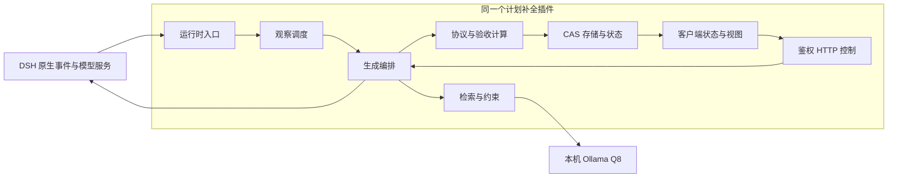

# 单插件内部组件审查

审查起点：PR #1 的 `f5cdf6c`，2026-11-04。本轮检查实际入口、依赖、打包清单与集成测试，并用长上下文实验核对关键行为。结论：**应继续拆内部组件，保留同一个插件、同一个 npm 包和一套设置。当前不需要拆成多个独立插件或服务。**

## 为什么需要拆

当前已经有 18 个 host JS 模块，但主要运行时编排仍集中在 `index.js`（1732 行），客户端仍是 `client.js`（2433 行）。行数只是线索；更具体的问题是同一闭包持有配置、模型适配、作业取消、会话状态、存储、检索、HTTP 和调试实验，难以单独验证生命周期与信任边界。

| 发现 | 影响 | 处理或建议 |
|---|---|---|
| 历史 `host/job.js` 905 行未被入口导入，却被旧接线指南称为等价替代 | 旧 runner 未接入原始回执和验收版本校验；回归复现它接受版本化步骤的模型 done 提案 | 本轮阻止旧 runner 接受带 acceptance 的计划，模型/提交/发布均不发生；纠正文档。属于已复现的潜在误接风险，不是当前生产入口绕过 |
| `index.js::runGeneration` 同时处理证据、RAG、模型、修复、协议、CAS 和发布 | 后续改造容易遗漏取消、手动编辑或版本检查 | 从当前实际流水线提取生成服务，不直接切换到旧 runJob |
| 生产证据裁剪函数放在 `host/experiment.js`，文件却声明只服务临时实验 | 实验代码与生产依赖边界不清 | 提取为独立证据预算组件，实验调用同一个生产工具；迁移时保留完整验收定义 |
| `evidenceChars` 裁剪后会重新加入协议快照、最新用户消息和检索结构 | 此设置不是整个模型提示的字符硬上限，完整验收条件占用另计 | 证据预算组件应分别统计结构化定义、回执和叙述预算，不能截断 ID 或半个验收定义 |
| Plan 规范化与检索策略通过 progress 模块间接依赖执行校验器 | 数据类型、模型提案格式与状态计算耦合 | 将协议 schema 与状态推导分开；类型规范化不依赖运行时调度或网络 |
| HTTP 鉴权后还有大量分支与共享状态操作 | 拆路由时容易遗漏鉴权、重置取消和 CAS | 所有路由共用一个鉴权包装，业务 handler 注入窄接口；不是每个模块各自实现鉴权 |
| RAG 后台 worker 总是先取第一个未完成会话 | 实际长测第二个会话出现 indexed=0、词法回退；单元回归复现大积压独占 | 本轮改为按会话轮流处理一批，不修改 TTL/LRU 活跃时间；检索服务后续应独立承担调度与统计 |
| 每次观察从完整日志收集回执，再裁为 32768 条；向量端也重新扫描后裁剪 | 输出有界，扫描和临时分配仍随原始日志增长 | 后续为证据组件设计按 seq 增量重建，保留原始/派生事件来源与重置边界；本轮没有把索引上限误当总内存上限 |
| Client 的请求竞态、状态缓存、快捷键与 React 渲染共处加载器工厂 | UI 变更难以独立测试，重复挂载或过期响应问题容易回归 | 源码按状态/传输、输入行为、视图拆分，构建后仍输出一个兼容 DSH 的 client.js |

没有发现必须拆进程才能解决的问题。把嵌入、计划状态和 UI 变成不同插件，会增加版本同步、重复订阅、跨插件清理和多套配置的负担；目前的状态权威必须保持唯一。

本轮已实施第一小步：新增 `host/progress-schema.js`，把协议数据规范与执行状态推导分离；Plan 和检索策略直接依赖规范化模块，旧导出仍兼容。同一个插件 ID、入口、HTTP 路由和存储格式保持不变。其余入口与 Client 的大规模迁移列为后续工作，没有混入本轮性能对照。

## 建议组件边界

| 组件 | 负责 | 不负责 |
|---|---|---|
| 入口与运行时适配 | 获取 DSH 服务、注册事件/路由、热重载与 dispose | 直接解释模型完成声明 |
| 观察调度 | 回合/工具/压缩边界、防抖、取消、过期作业检查 | 决定完成状态、写模型提示 |
| 生成服务 | 协调证据、检索、模型输出、协议校验、CAS 提交 | 自己建立第二套验收规则 |
| 进度领域 | 计划类型、信封 schema、版本边界、依赖图、回执推导 | HTTP、模型调用、向量相似度 |
| 检索服务 | 来源分类、约束保留、本机嵌入、索引、检索与覆盖统计 | 直接写 done、升级验收版本 |
| HTTP 控制与状态查询 | 统一鉴权、参数校验、调用服务、脱敏响应 | 绕开生成服务直接合并模型结果 |
| Client 状态/传输 | 请求身份、缓存、轮询、卸载清理 | 重算业务完成状态 |
| Client 交互/视图 | Tab 填入、焦点/弹窗门控、紧凑状态、计划和设置面板 | 自动发送、信任未校验的本地状态 |

其中进度领域与检索服务仍是同插件的普通模块，不必各自注册成 Cordis 插件。原始会话事件为执行事实来源；模型提案和向量结果都不能跨过宿主验收边界。

图中的模型服务调用是计划助手旁路，主 Agent 的原生回复和上下文仍由 DSH 管理。拆组件不会要求每个组件各启动一个模型或独立进程。

## 迁移顺序与验收门槛

1. 先修正旧 runner 误接风险，分开稳定的协议数据规范与计算逻辑。保持导出兼容，不改插件 ID、路由和存储格式。
2. 提取证据预算、模型调用适配和鉴权路由包装；这些职责边界明确，可以先保持调用顺序完全一致。
3. 从生产 `runGeneration` 提取唯一生成服务，再收拢观察调度。迁移前后都跑 Host 接线、并发取消、CAS、恢复/压缩、手动编辑、鉴权和隐私测试，并对同一合成事件比较状态。
4. 最后拆 Client 源文件。当前产物依赖 `window.__ModuleLoader__.load` 和工厂内 require；不能直接在浏览器文件顶部增加 Node/ESM 相对 import 并假定加载器支持。

打包需特别注意：当前 package.json 仅列出 `host/*.js`，不包含未来的多层 host 子目录；若改目录结构，必须同步 files 配置，并验证 npm 打包产物能加载。当前没有客户端构建链，新增源码目录时需要确定可复现构建和产物检查，避免只在源码 checkout 中通过。

不建议在本轮百万上下文性能对照中同时整体迁移入口和 UI。性能或状态发生变化时，需要能定位是协议修复还是编排变化。先保留审计证据和小范围安全修复，再按上述边界分阶段迁移。测试数量不能证明旧 runner 与生产入口等价，生产接线测试应持续保留。
