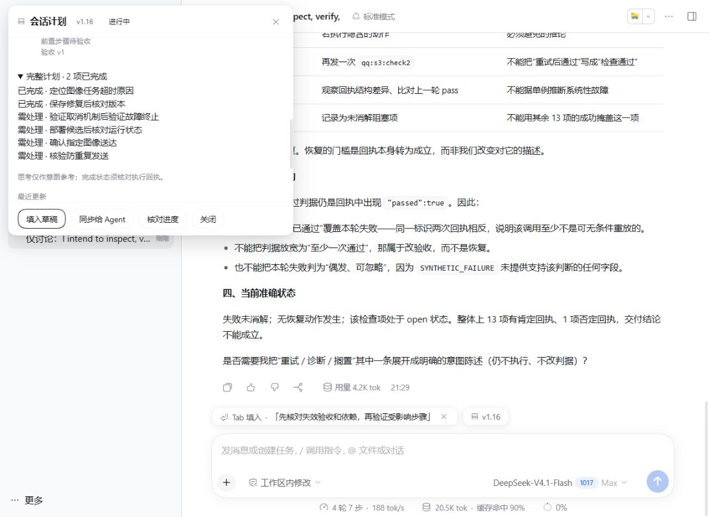
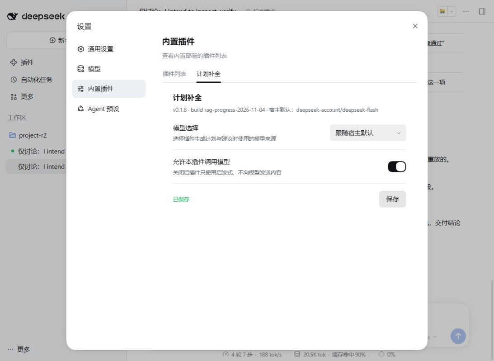

# 多组件候选版隔离验收

日期：2026-11-04。PR #1；未合并、未发布 npm、未替换生产桌面插件。结构见[组件说明](component-audit.md)，可核对的脱敏数值见[数据摘要](data/components-20261104.json)。

## 结论与范围

本轮修复与拆分的验收矩阵通过：250/250 回归、8/8 真实模型合成状态检查点、9/9 真实加载器检查，以及界面与包导入验证。这里的 PASS 是这些明确场景的结果，不代表所有任务或环境没有风险。

使用本机 DSH 0.2.1-rc.5 的真实 boot、Loader、会话、Agent、原始日志与鉴权服务；生成模型为当前 DeepSeek-V4.1-Flash。只有工具执行结果是允许列表中的合成模拟器，不执行系统命令、QQ 发送或文章发布。Codex 只编排测试，不充当被测模型。

DSH 主模型报告 contextWindow=1,048,576、defaultMaxTokens=256,000；没有为这轮测试缩短原生上下文或调整压缩预算。计划助手仍是旁路调用，默认 patch=800 / rewrite=1200。官方 Qwen3-Embedding-0.6B Q8 仍由本机 Ollama 的 `dsh-qwen3-embedding:q8_0` 提供。

## 三项修复与回归

| 问题 | 结果 |
|---|---|
| 固定模型不可用时可能回退到默认供应商 | 缺配置、返回空、解析抛错都停止调用；切换设置取消生成与核对，晚到结果丢弃 |
| 恢复时信任磁盘旧完成状态、未知长度日志只检查前页 | 恢复后重验原始日志和验收版本；不可读时隐藏旧 done/proof；分页读取并在超限时标为待核验 |
| 新模型输出可能走旧格式兼容、绕过协议要求 | 生产输出强制进度协议与验收定义；一次修复失败后给出显式未验证人工计划 |

新增审计及组件回归覆盖上述失败路径、跨步骤失效、旧配置迁移、组件卸载、取消、鉴权和恢复。还修复了空 proof 表示导致版本无意义增长，以及旧 profile 覆盖新标记后重新启用被禁用组件的问题。

## 真实合成任务

最终 r2 的 QQAgent 与小黑盒文章流程各有四个检查点：只有中文意图/英文思考 → 全部 todo；原始成功回执齐全 → 六步 done；第三步出现更新的失败回执 → 前两步 done、其后四步 blocked；关闭 RAG 后仅宣称完成 → 仍保持失效状态。8/8 匹配预期，没有在这些样本中发现假完成。

Q8 首次后台嵌入尚未完成时走词法检索，两个会话均在后续阶段转为 hybrid。热检索 67–105 ms；完整阶段 4.56–20.26 s。9 次未取消的助手调用为 0.97–1.85 s；共尝试 24 次助手调用，其中 15 次因更新的工具事件等被取消。这是已有取消策略的成本，尚不能声称工具密集任务的助手请求开销已最优。

r1 另跑了不预置计划的冷启动：默认助手预算下 6.09 s 生成三步版本化待办，没有预判完成。r2 使用已定义的验收条件测完成/失效，不能拿它代替自由生成计划质量评测。

此处关闭 RAG 的检查点用于状态安全验证，不是同输入随机重复的速度 A/B；不能据此宣布 RAG 让整体任务更快。此前[三组对照](q8-rag-ab-validation.md)和[近 1M / 连续压缩](protocol-long-validation.md)保留原实验口径，本次组件拆分没有重新执行其完整真实长测。

## 真实加载器与界面

四个子组件分别停/启、旧根配置覆盖后恢复文件计划、旧配置不复活禁用观察器、根服务级联停/启、真实 HTTP 认证、UI 设置持久化，共 9/9 组通过。五行组件加载状态均为 active。未认证状态查询 401；DSH 原生 launch-token 换取 cookie 后查询 200；默认调试路由 404。初版验证脚本误用 Bearer，改为宿主 cookie 交换后通过，不修改产品鉴权以迁就测试。

界面使用隔离 DSH 的真实共享 Web 前端，检查计划弹窗、验收 v1、2 done / 4 blocked 展示、Tab 仅填草稿、关闭/恢复模型调用并保存。不是截图模拟页面；也没有给生产 Electron 进程注入候选插件。本轮没有重测 Electron 主进程的 dsh-app HTTP 代理。

## 资源、隐私与发布边界

隔离 DSH 进程 RSS 峰值 261.6 MiB，包含运行时、Web 服务和插件，不是插件单独内存，也不包括 Ollama。样本规模不能代表接近 1M 时的资源上界。

对外请求目标仅 api.deepseek.com；嵌入请求留在本机 Ollama。所有发送内容来自合成任务。网络日志保留两次 transport 失败，最后状态及恢复断言通过，不把它们写成零故障。生产配置、凭据文件与合成工作区哨兵的前后哈希均未变化。

发布前检查候选源文件及实际 npm tarball，排除私有适配器、凭据、原始会话日志和测试 home；当前凭据值精确匹配扫描无泄漏。常见密钥模式仍需区分回归中的虚构测试值；这不是完整 Git 历史或渗透测试。实际 tarball 在单独目录安装并导入根入口及四个组件，npm 包中保持同一客户端和清单。

计划目录仍是本地明文；开启外部生成会发送会话派生片段，脱敏不能保证消除所有业务隐私。详见[安全边界](security.md)。隔离实例已退出；用户运行中的桌面实例与 Ollama 未停止。
