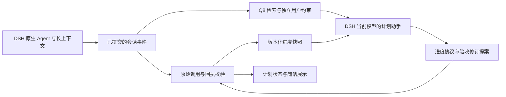

# 统一进度协议与验收版本

此候选在计划助手旁路实现 `progress.version=1`。DSH 主 Agent 继续输出原生回复、使用原生长上下文；插件不向主 Agent 注入新系统提示、不给它新增工具，也不改写会话历史。官方 Q8 仍只负责检索中文会话、英文思考意图和证据位置。主 Agent 的自然语言回复不要求变成 JSON。

计划助手沿用现有观察与防抖作业，通过单独的 JSON 信封提出验收修订、引用工具回执。宿主从当前会话的原始事件推导状态；模型说“完成”、英文思考、压缩摘要、向量相似度和已保存的 proof 都不能直接授权 done。没有为每条工具回执增加一个新模型调用。

## 数据流



## 验收定义

每步可带 `acceptance: {scope, dependsOn, revision, afterSeq}`。模型仅提出 scope 和 dependsOn，宿主生成 revision 和 afterSeq。dependsOn 是 `{stepId, revision}` 数组，精确绑定前置步骤的验收版本；没有真实依赖时不要按步骤位置强行串联。

| scope | 可证明的范围 |
|---|---|
| execution | 指定工具操作执行成功，不证明业务交付 |
| submission | 末项明确 `accepted/submitted=true`，或 status/state 是 accepted/submitted |
| delivery | 末项明确 `delivered=true`，仅受理不能通过 |
| deployment | 包含 `installed=true`，且末项 installed/ready=true |
| assertion | 末项有明确标量 expect，排除 ok/success/accepted/status 等泛化运输状态 |
| manual | 无可靠工具验收，保留人工确认 |

`completion` 仍为 `{tool,args,expect?}` 或 `{all:[...]}`；复合验收 2–6 项，每项需要自己的回执且按指定顺序发生。args 绑定目标，expect 精确比较回执 JSON 顶层标量。scope 能阻止“delivery 使用 accepted=true”这种已知错配，但不能判断人类目标本身是否被正确拆解。错误地选择 execution、编造业务条件或漏建依赖仍需复核。

首次定义或修改验收时，宿主记录当前事件序号作为 afterSeq。只有此序号之后新发起的调用才能用于新版验收；旧调用即使延迟返回，也不能把旧结果移入新版本。工具调用、成功回执、验收项顺序、期望字段和依赖全部通过后，宿主才生成证据 ID 与 proof 指纹。proof 是变化标记，不是签名，也不能代替日志重建。

## 进度信封

每次计划助手返回包含 `progress: {version:1, events:[]}`。没有新事件时数组为空。每步每批最多一个事件、总计最多七个；未知字段、重复步骤和不合法 ID 拒绝。

| event | 内容和效力 |
|---|---|
| step_started | 当前验收版本与本会话 tool_call 的 evidence_ids |
| evidence_added | 当前验收版本与本会话 tool_result 的 evidence_ids |
| step_blocked | 当前验收版本与失败 tool_result 的 evidence_ids |
| acceptance_proposed | 当前版本，以及放在该事件内部的完整 acceptance、completion；禁止 evidence_ids |
| dependencies_proposed | 仅修改依赖：当前版本及 depends_on:[{stepId,revision}]；宿主复用既有 scope/completion，不允许模型在此事件改写它们 |

前三类仅是引用与提示，不是写状态命令；宿主仍独立核对最新原始事件。版本号不匹配、跨会话 ID、错误类型和伪造 ID 拒绝。修订例：

后两类修改验收定义，是计划元数据提案，不执行工具，也不需要新的工具回执。用户明确要求修改时，计划助手在当前响应的 `progress.events` 中提交；`op=none` 不代表必须没有事件。原生 Agent 无法调用计划接口、或用户要求本轮不调用工具，都不能成为延后定义提案的理由。宿主接受后会升级版本并清除旧证明；步骤完成仍须等待新边界之后的实际执行回执。没有明确修改要求时不自行升级验收。

```json
{
  "op": "none",
  "reason": "目标升级，需要新验收",
  "progress": {
    "version": 1,
    "events": [{
      "step_id": "s2",
      "acceptance_revision": 1,
      "event": "acceptance_proposed",
      "acceptance": {"scope": "assertion", "dependsOn": [{"stepId": "s1", "revision": 2}]},
      "completion": {"tool": "exec", "args": {"command": "test-new-version"}, "expect": {"field": "passed", "equals": true}}
    }]
  },
  "constraints": [],
  "suggestion": "按新版验收执行并核对回执"
}
```

修改没有实质变化时不升版。有效修订按当前版本比较后递增，不能降级 scope、删除依赖、丢失原有工具/参数键或弱化布尔要求；允许更新明确目标/版本。对旧条件已不符合其 scope 的情况，允许修正为满足该 scope 的明确字段。循环、缺失前置步骤和错误版本拒绝。

长上下文验证增加了 `dependencies_proposed`：只改前置版本时，不再要求计划助手重复抄写所有验收条件。它不能用于首次定义（版本 0），不能夹带 completion/acceptance/evidence_ids，仍受版本比较、禁止删依赖和循环检查。原有完整 `acceptance_proposed` 保持兼容。计划字段来自宿主，原生助手声称“我看不到插件定义”不能否定 plan.steps 已提供的数据。

协议数据规范已从执行计算中分离为 `host/progress-schema.js`；`progress-protocol.js` 保留兼容导出。Plan 类型与检索策略不再通过执行校验器取得规范化函数，仍由一个插件提供服务。

批量修订必须在同一 events 内按依赖顺序提交全部事件。事件的 acceptance_revision 是该步骤提交前版本；dependsOn 可引用本批前面已生成的新版本。宿主不自动为所有下游升级依赖，避免把“上游变更”误当作“下游已接受新目标”。部分事件失败时，已通过的事件可能生效；这是顺序处理，**不是事务型全有或全无**，界面明确提示仍有未生效项。

## 跨步骤失效与展示

前置步骤执行失败、重新执行、验收升版或证据缺失，都会使依赖链重新核对。下游旧回执必须晚于前置步骤最新完成回执，且依赖版本一致；否则撤销自动完成，展示“依赖待核验/依赖版本变化/旧验证失效”等状态。即使上游验收版本没变，新执行也会使旧下游验证失效。

此规则有意保守：相同内容的重复执行也可能使下游失效，目前不按内容哈希证明“重跑无变化”。只追踪明确声明的依赖和被日志观察到的工具调用，不是工作区文件监控器；外部编辑和漏建依赖不在自动检测范围内。不要为了清除状态而自动重发消息或执行部署，优先只读复核或人工确认。

版本化步骤不能被模型通过旧 changes.status、改名、删除、rewrite 或 dropped 绕过验收。失效依赖或被拒绝提案时，建议文字由宿主替换为核验提示，避免显示“全部通过，可以收尾”。紧凑条显示验收 vN，用户手动编辑保持优先；人工完成不作为依赖链的自动工具证据。

## 兼容、容量与隐私

- 旧输出未带 progress 时适配为空事件，不影响旧模型输出可读性。旧计划未带 acceptance 时仍走旧校验；不会推测所有历史步骤的 scope/依赖并静默迁移。重新规划时声明 acceptance，或用当前版本 0 的 acceptance_proposed 显式建立定义；历史回执不能追认新定义。
- 新计划提示要求 acceptance，但解析仍兼容未声明它的旧格式。故不能把“协议已接入”理解为所有历史计划已经有版本化保证。检查是否显示验收 vN。
- 当前原始回执重建最多 32768 条、向量索引最多 8192 条；原始证据丢失后保守撤销证明。独立约束保留仍有界并提示不完整，不承诺无限历史。
- 快照只含版本、状态、来源 ID、依赖和指纹，不增加正文或工具参数副本。既有计划条件仍会按原来的脱敏与预算规则进入计划模型。
- Q8 嵌入仍仅允许 loopback；嵌入与向生成器发送检索内容分别默认关闭。开启外部 DeepSeek 计划模型后，脱敏后的证据会沿授权模型路由发送，不能称为全本地或零外发。脱敏不是通用个人信息识别。

最新实测、失败记录、性能和复现入口见 [接近1M与连续自动压缩验证](protocol-long-validation.md)。此前的 [短任务协议验证](progress-protocol-validation.md) 与 [复杂任务报告](complex-task-validation.md) 是旧提交的历史结果，不应当作当前代码的完整验收。
